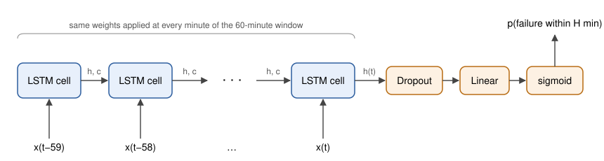
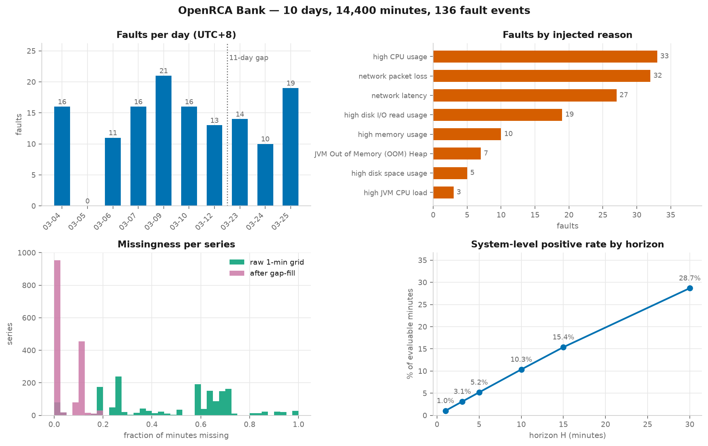
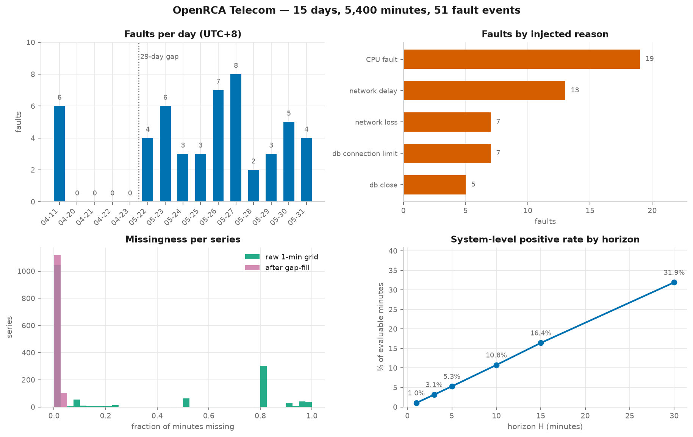

Slides: [slides.html](slides.html){target="_blank"} ( Go to `slides.qmd`
to edit)

## Introduction

Modern software systems generate large amounts of telemetry data, including
performance metrics, logs, and other operational signals. This information may
contain early warning signs of system failures; however, detecting those signs
can be challenging, especially in complex systems. Improving failure prediction
can help organizations respond earlier, reduce system downtime and associated
costs, and improve overall system reliability.

This project will use Microsoft's OpenRCA dataset [@xu2025openrca] to
investigate whether Long Short-Term Memory (LSTM) neural networks can predict
impending software-system failures from system telemetry. Because LSTMs are
designed to learn patterns over time, they may be useful for detecting changes
in telemetry data that occur before a system failure. We will evaluate how
accurately failures can be predicted at different time horizons and whether
combining multiple telemetry sources improves prediction performance compared
with using a single source. Overall, this project applies machine learning to a
practical software reliability problem by testing the effectiveness of telemetry
data for early failure detection.

Previous research is supportive of using LSTM models in the analysis of sequential data.
[@Gonzalez2018] showed that LSTM networks can be used in modeling nonlinear systems,
while [@ErgenKozat2020] used LSTM-based methods for anomaly detection in data sequences
with variable length. Other studies applied LSTMs to telemetry data obtained from computer
systems. [@MudgalWouhaybi2024] used a combined LSTM encoder in anomaly detection methods.
These include Isolation Forest, used to identify PC system failures from CPU, memory, disk,
temperature, and system data. This study obtained results that suggested LSTM-based telemetry
analysis can provide useful results for system-failure detection.

System log research also shows how important sequential modeling can be in failure-related
tasks. [@Chen2022] used two LSTM networks in the analysis of events before and after a log
entry; this improved anomaly detection in long log sequences. In addition, [@Hadadi2024]
researched deep learning for log-based failure prediction and found that model performance is
dependent on how log data are represented and transformed into sequences. The OpenRCA dataset
will be particularly useful in this project as it contains real failure case data from enterprise
systems, with multiple sources of telemetry, such as logs, metrics, and traces [@Xu2025].
While the prior work mentioned mainly focused on anomaly detection or cause analysis, this
project will be more focused on predicting failures before they occur and testing the efficacy
of multiple telemetry sources in improving early failure prediction performance.

## Methods

A Long Short-Term Memory (LSTM) network is a type of recurrent neural network (RNN)
designed to learn from sequential data while retaining useful information over time.
As it processes each time step, the LSTM updates a cell state that carries information
forward. Three gates control this process: the forget gate determines what information
to retain, the input gate determines what new information to add, and the output gate
determines what information to expose to the next time step. This gating structure
helps the network learn which patterns of change over time are useful for making
predictions [@Hochreiter1997].

We chose an LSTM because it can learn from the order of telemetry measurements over
time. Some faults may be preceded by gradual changes in metrics, such as increasing
memory use or CPU utilization that remains elevated. By processing a recent sequence
of measurements, the model can learn whether these patterns help predict a fault before
it begins. This section explains how the LSTM processes sequences, the assumptions
behind our modeling approach, how we prepare OpenRCA telemetry for the model, and how
we train it.

### Recurrent Neural Networks and the Vanishing Gradient

A recurrent neural network processes a sequence $x_1, x_2, \dots, x_T$ one step at
a time. At each step it combines the current input $x_t$ with a *hidden state*
$h_{t-1}$ that summarizes everything it has seen so far:

$$
h_t = \tanh\left(W x_t + U h_{t-1} + b\right)
$$ {#eq-rnn}

The same weights $W$, $U$ and $b$ are reused at every time step, so the network can
handle a sequence of any length with a fixed number of parameters.

RNNs are trained with *backpropagation through time* (BPTT) [@Werbos1990]: the
network is "unrolled" over the sequence, and the error at the final step is passed
backwards through every earlier step. The gradient that reaches step $t-k$ contains
a product of $k$ Jacobian matrices,

$$
\frac{\partial h_t}{\partial h_{t-k}} = \prod_{j=t-k+1}^{t} \operatorname{diag}\!\left(1 - h_j^2\right) U .
$$ {#eq-bptt}

When the terms in this product are smaller than one, the gradient shrinks
exponentially as $k$ grows (it *vanishes*); when they are larger than one, it grows
exponentially (it *explodes*) [@Bengio1994; @Pascanu2013]. In practice, a plain RNN
therefore learns only short-range patterns. For our problem, this is a serious
limitation: an early warning sign 20 minutes before a fault is 20 steps back in the
sequence.

### Mathematical Foundations of the LSTM

The LSTM replaces the single update in @eq-rnn with a memory cell $c_t$ and three
gates. Following the standard formulation with a forget gate [@Gers2000], the
computation at each time step $t$ is:

$$
\begin{aligned}
f_t &= \sigma\left(W_f x_t + U_f h_{t-1} + b_f\right) && \text{forget gate}\\
i_t &= \sigma\left(W_i x_t + U_i h_{t-1} + b_i\right) && \text{input gate}\\
o_t &= \sigma\left(W_o x_t + U_o h_{t-1} + b_o\right) && \text{output gate}\\
\tilde{c}_t &= \tanh\left(W_c x_t + U_c h_{t-1} + b_c\right) && \text{candidate memory}\\
c_t &= f_t \odot c_{t-1} + i_t \odot \tilde{c}_t && \text{cell state update}\\
h_t &= o_t \odot \tanh\left(c_t\right) && \text{hidden state (output)}
\end{aligned}
$$ {#eq-lstm}

where:

- $x_t$ is the input vector at time $t$: the telemetry readings for one minute.
- $h_{t-1}$ is the hidden state from the previous minute; $h_t$ is the new one.
- $c_{t-1}$ and $c_t$ are the old and new **cell states** — the long-term memory.
- $f_t$, $i_t$, $o_t$ are the **gates**. Each is a vector of numbers between 0 and 1
  produced by the logistic sigmoid $\sigma(z) = 1/(1+e^{-z})$. A value near 0 means
  "block" and a value near 1 means "let through".
- $\tilde{c}_t$ is the **candidate memory**: new information that could be written
  to the cell. The $\tanh$ function keeps it between $-1$ and $1$.
- $W_\ast$ are the input weight matrices, $U_\ast$ are the recurrent weight matrices, 
  and $b_\ast$ are bias vectors, one set for each gate and the candidate.
- $\odot$ is element-wise (Hadamard) multiplication.

**What each gate does.**

- The **forget gate** $f_t$ decides how much of the old memory $c_{t-1}$ to keep.
  If a component of $f_t$ is close to 1, that part of the memory is carried forward;
  close to 0, it is erased.
- The **input gate** $i_t$ decides how much of the candidate $\tilde{c}_t$ is written
  into memory. This lets the network ignore minutes that carry no useful information.
- The **output gate** $o_t$ decides how much of the memory is exposed in the hidden
  state $h_t$, which is what the next step — and eventually the prediction layer —
  sees.

**Why this fixes the vanishing gradient.** The key line in @eq-lstm is the cell
update $c_t = f_t \odot c_{t-1} + i_t \odot \tilde{c}_t$. It is *additive*, not a
repeated squashing like @eq-rnn. Along this path, the gradient from one step to the
previous is

$$
\frac{\partial c_t}{\partial c_{t-1}} \approx \operatorname{diag}(f_t),
$$

so as long as the network learns to keep the forget gate open ($f_t \approx 1$), the
error signal can travel back across many time steps without shrinking. This is the
"constant error carousel" that gives the LSTM its long memory [@Hochreiter1997].

#### Matrix and Vector Dimensions

Let $k$ be the number of input features and $d$ the number of hidden units. Then:

| Symbol | Dimension | Meaning |
|---|---|---|
| $x_t$ | $k \times 1$ | telemetry at minute $t$ |
| $h_t,\; c_t,\; f_t,\; i_t,\; o_t,\; \tilde{c}_t$ | $d \times 1$ | hidden state, cell state, gates, candidate |
| $W_f, W_i, W_o, W_c$ | $d \times k$ | input weights |
| $U_f, U_i, U_o, U_c$ | $d \times d$ | recurrent weights |
| $b_f, b_i, b_o, b_c$ | $d \times 1$ | biases |

The four weight sets are usually stacked into one matrix, so a single LSTM layer has

$$
4\left(dk + d^2 + d\right)
$$

trainable parameters. In this project, the input has $k = 128$ selected telemetry
features and the LSTM has $d = 64$ hidden units, which gives
$4(64 \cdot 128 + 64^2 + 64) = 49{,}408$ parameters in the LSTM layer. (PyTorch keeps
two bias vectors per gate, which adds another $4d = 256$.) The prediction layer
described below adds $d + 1 = 65$ more, for a total of $49{,}729$ parameters.
Importantly, this number does not depend on the length of the sequence: the same
weights are applied at every minute.

#### Example

To make @eq-lstm concrete, consider a toy LSTM with $d = 1$ hidden unit that watches
$k = 2$ scaled telemetry features of one container: CPU usage and memory usage. At
the previous minute, the network's state was $h_{t-1} = 0.2$ and $c_{t-1} = 0.5$. At
the current minute, CPU usage spikes while memory is normal:

$$
x_t = \begin{bmatrix} \text{CPU} \\ \text{Memory} \end{bmatrix}
    = \begin{bmatrix} 1.5 \\ 0.3 \end{bmatrix}
$$

Suppose training has produced the following weights:

| Gate | $W_\ast$ (CPU, Memory) | $U_\ast$ | $b_\ast$ |
|---|---|---|---|
| forget $f$ | $[\,0.6,\; -0.2\,]$ | 0.5 | 1.0 |
| input $i$ | $[\,0.8,\; 0.1\,]$ | 0.3 | 0.0 |
| output $o$ | $[\,0.4,\; 0.2\,]$ | 0.6 | 0.2 |
| candidate $\tilde{c}$ | $[\,0.9,\; 0.3\,]$ | 0.4 | $-0.1$ |

**Step 1 — gates.** For the forget gate,

$$
f_t = \sigma(0.6 \cdot 1.5 - 0.2 \cdot 0.3 + 0.5 \cdot 0.2 + 1.0) = \sigma(1.94) = 0.874 .
$$

The other gates follow in the same way:

$$
i_t = \sigma(1.29) = 0.784, \qquad
o_t = \sigma(0.98) = 0.727, \qquad
\tilde{c}_t = \tanh(1.42) = 0.890 .
$$

**Step 2 — update the memory.**

$$
c_t = \underbrace{0.874 \times 0.5}_{\text{kept from before}}
    + \underbrace{0.784 \times 0.890}_{\text{newly written}}
    = 0.437 + 0.698 = 1.135
$$

**Step 3 — produce the output.**

$$
h_t = 0.727 \times \tanh(1.135) = 0.727 \times 0.813 = 0.591
$$

The network kept most of its earlier memory (87 %) and added a large new
contribution because the CPU spike opened the input gate. The value of $c_t$ has
grown from 0.5 to 1.135, so the "something unusual is happening" signal will be
carried into the next minutes. Repeating these three steps for every minute of
the look-back window is all the LSTM does; training consists of finding weights
that make this memory useful for predicting failures.

#### From a Sequence to a Failure Prediction

For each minute $t$ we give the LSTM the previous $L = 60$ minutes of telemetry,
$x_{t-59}, \dots, x_t$, and run @eq-lstm over them in order. Only the final hidden
state $h_t$ is used for the prediction, because by then it summarizes the whole
window. It passes through dropout and a single linear layer, and a sigmoid turns
the result into a probability:

$$
\hat{p}_t = \sigma\!\left(v^{\top} \operatorname{Dropout}(h_t) + b_v\right),
$$ {#eq-head}

where $v$ is a $d \times 1$ weight vector and $b_v$ is a scalar. $\hat{p}_t$ is the
model's estimated probability that a failure will start within the next $H$ minutes.

{#fig-unrolled width="100%"}

### Parameter Estimation

The parameters $\theta = \{W_\ast, U_\ast, b_\ast, v, b_v\}$ are learned by minimizing
a **weighted binary cross-entropy** loss over the $N$ training windows:

$$
\mathcal{L}(\theta) = -\frac{1}{N}\sum_{n=1}^{N}
\Big[\, w_{+}\, y_n \log \hat{p}_n + (1 - y_n)\log\left(1 - \hat{p}_n\right) \Big]
$$ {#eq-loss}

where $y_n \in \{0, 1\}$ is the true label. Failures are rare, so the positive-class
weight $w_{+}$ is set to the ratio of negative to positive windows in the training
data. Without this weight the model could reach a low loss by always predicting
"no failure".

Gradients of @eq-loss are computed by backpropagation through time and the weights
are updated with the **Adam** optimizer [@Kingma2015], which adapts the step size for
each parameter. Several standard techniques keep training stable and reduce
overfitting:

- **Gradient clipping.** If the overall gradient norm exceeds 5 it is rescaled to 5.
  This guards against the exploding-gradient problem described above [@Pascanu2013].
- **Dropout** with rate 0.2 on the final hidden state randomly zeroes units during
  training, so the prediction cannot rely on any single unit [@Srivastava2014].
- **Weight decay** of $10^{-5}$ adds a small L2 penalty on the weights.
- **Early stopping.** After each epoch the model is scored on a separate validation
  set. Training stops when the validation score has not improved for 4 epochs, and
  the weights from the best epoch are restored.

| Setting | Value |
|---|---|
| Look-back window $L$ | 60 minutes |
| Input features $k$ | 128 |
| Hidden units $d$ | 64 |
| LSTM layers | 1 |
| Dropout | 0.2 |
| Optimizer | Adam, learning rate $10^{-3}$, weight decay $10^{-5}$ |
| Batch size | 128 |
| Maximum epochs | 15 |
| Early-stopping patience | 4 epochs (on validation PR-AUC) |
| Gradient clipping | max norm 5 |

: Default LSTM configuration. {#tbl-config}

## Analysis and Results

### Dataset Description

The data come from **OpenRCA** [@xu2025openrca], a public benchmark released by
Microsoft for root-cause analysis of software failures. OpenRCA collects telemetry
from three enterprise microservice systems: **Bank**, **Telecom** and **Market**
(the last split into two deployments, `cloudbed-1` and `cloudbed-2`), into which
engineers deliberately injected faults such as CPU exhaustion, memory leaks and
network delays. For every system, OpenRCA provides:

- **Telemetry**, organised into one folder per day, with three modalities:
  - **metrics** — numeric key performance indicators (KPIs) such as CPU use, memory
    use, response time, and request counts, sampled every few seconds to minutes;
  - **logs** — text messages written by the services;
  - **traces** — records of individual requests travelling between services.
- **A fault record** (`record.csv`) listing every injected fault with its start
  time, the component it was injected into, and the type of fault.

**Scope of this study.** We focus on the **Bank** and **Telecom** systems and on their
**metric** telemetry only. We chose these two systems because:

1. Each is a single, self-contained system with one fault record, so the telemetry
   and the labels line up directly. Market is split into two separate deployments
   that would each need their own pipeline.
2. They are very different from each other — different business domains, numbers of
   components, monitoring tools and time periods — so a result that holds on both
   is more convincing than a result on one.
3. Metrics are numeric time series that can be placed on a common one-minute grid,
   which is the input the LSTM needs. Logs and traces would first require text
   parsing and request-level aggregation, which is outside the scope of this project.

| | **Bank** | **Telecom** |
|---|---|---|
| Domain | Online banking platform | Telecom operator services |
| Recorded days | 10 (2021-03-04 to 2021-03-25, not consecutive) | 15 (2020-04-11 to 2020-05-31, not consecutive) |
| Telemetry per day | 24 hours (1,440 minutes) | 6 hours, 00:00–05:59 (360 minutes) |
| Total minutes | 14,400 | 5,400 |
| Metric files per day | `metric_container.csv`, `metric_app.csv` | `metric_node.csv`, `metric_container.csv`, `metric_middleware.csv`, `metric_service.csv`, `metric_app.csv` |
| Timestamp unit | seconds | milliseconds |
| Injected faults | 136 | 51 |
| Fault types | 8 | 5 |

: Overview of the two OpenRCA systems used in this study. {#tbl-systems}

All OpenRCA timestamps are Unix epoch values, and all dates and day-folder names are
in **UTC+8** (China Standard Time). Dates and times in this report are shown in UTC+8.

#### Variable Description

The **fault record** has the same columns in both systems:

| Variable | Description |
|---|---|
| `level` | Level of the system where the fault was injected: `pod` (a container), `node` (a host machine) or `service`. All Bank faults are at pod level. |
| `component` | Name of the component the fault was injected into, for example `Mysql02` (Bank) or `docker_003` (Telecom). |
| `timestamp` | Fault start time as a Unix epoch value (seconds). |
| `datetime` | The same start time written as a date and time in UTC+8. |
| `reason` | Type of fault, for example `high CPU usage` or `network delay`. |

: Columns of `record.csv`. {#tbl-record-vars}

The record gives each fault's **start time only**; it does not say how long the fault
lasted. This is important for labeling, described below.

The **metric files** come in two layouts:

| Layout | Files | Columns | Meaning |
|---|---|---|---|
| Long (one row per reading) | Bank `metric_container.csv`; all Telecom files except `metric_app.csv` | `timestamp`, `cmdb_id`, `kpi_name` / `name`, `value` | At time `timestamp`, KPI `kpi_name` on component `cmdb_id` had value `value`. |
| Wide (one row per service per time) | Bank and Telecom `metric_app.csv` | Bank: `timestamp`, `tc`, `rr`, `sr`, `cnt`, `mrt`; Telecom: `startTime`, `serviceName`, `avg_time`, `num`, `succee_num`, `succee_rate` | Application-level request statistics: request count, success rate and mean response time per service. |

: Layouts of the metric files. {#tbl-metric-layout}

Each combination of a component and a KPI — for example `Tomcat04 ‖ CPU utilisation` —
is one **time series**, and becomes one input feature for the model.

### Load Data

```{r, warning=FALSE, echo=TRUE, message=FALSE}
# loading packages
library(tidyverse)
library(knitr)
```

The fault records are small and are loaded directly. Start times are converted from
epoch seconds to UTC+8 date-times.

```{r, echo=TRUE}
read_record <- function(path, system) {
  read_csv(path, show_col_types = FALSE) |>
    transmute(system    = system,
              level,
              component,
              reason,
              timestamp = as.numeric(timestamp),
              onset     = as.POSIXct(timestamp, origin = "1970-01-01",
                                     tz = "Asia/Shanghai"))   # UTC+8
}

faults <- bind_rows(
  read_record("data/bank_record.csv",    "Bank"),
  read_record("data/telecom_record.csv", "Telecom")
)

faults |>
  group_by(system) |>
  slice_head(n = 3) |>
  select(system, level, component, reason, onset) |>
  kable(caption = "First three faults in each system's record.")
```

```{r, echo=TRUE}
faults |>
  count(system, reason, name = "faults") |>
  group_by(system) |>
  mutate(share = scales::percent(faults / sum(faults), accuracy = 1)) |>
  arrange(system, desc(faults)) |>
  kable(caption = "Injected fault types by system.")
```

Both systems are dominated by a few fault types. In Bank, high CPU usage, network
packet loss and network latency make up two-thirds of all faults, while JVM CPU load
(3 faults) and disk space (5 faults) are too rare to evaluate on their own. In
Telecom, CPU faults and network delay make up 63 %.

```{r, echo=TRUE}
faults |>
  mutate(day = as.Date(onset, tz = "Asia/Shanghai")) |>
  count(system, day, name = "faults") |>
  group_by(system) |>
  summarise(days_with_faults = n(),
            min_per_day      = min(faults),
            max_per_day      = max(faults),
            total            = sum(faults)) |>
  kable(caption = "Faults per day.")
```

Bank has faults on 9 of its 10 days and Telecom on 11 of its 15 days. The days with
telemetry but **no recorded faults** (Bank 2021-03-05; Telecom 2020-04-20 to
2020-04-23) are kept in the data as fault-free periods.

The metric telemetry is much larger — about 16 GB for Telecom and roughly 90 MB per
day for Bank — so it is not stored in this repository. It is read day by day in Python
with pandas. The function below reads one metric file and turns it into a table with
one row per minute and one column per `component‖KPI` series; the long and wide
layouts in @tbl-metric-layout are handled separately:

```python
def load_source(day_dir, src, grid):
    """Read one metric file into a minute x feature table ('component||kpi')."""
    if src.kind == "long":
        df = pd.read_csv(day_dir / src.path,
                         usecols=[src.ts_col, src.id_col, src.kpi_col, src.val_col])
        df["minute"] = to_minute(df[src.ts_col], src.ts_unit)   # s or ms -> minute
        df["feature"] = df[src.id_col] + "||" + df[src.kpi_col]
        wide = df.pivot_table(index="minute", columns="feature",
                              values=src.val_col, aggfunc="mean")
    else:  # wide layout (metric_app.csv)
        df = pd.read_csv(day_dir / src.path)
        df["minute"] = to_minute(df[src.ts_col], src.ts_unit)
        wide = pd.concat([df.pivot_table(index="minute", columns=src.id_col,
                                         values=v, aggfunc="mean")
                            .add_prefix("app||").add_suffix("." + v)
                          for v in src.value_cols], axis=1)
    return wide.reindex(grid)          # exact 1-minute grid for that day
```

Running this for every metric file and every day produces the raw feature tables:

| | **Bank** | **Telecom** |
|---|---|---|
| Rows (minutes) | 14,400 | 5,400 |
| Components in the telemetry | 18 | 51 |
| Raw `component‖KPI` series | 1,933 | 2,073 |
| Cells missing in the raw 1-minute grid | 48.3 % | 25.5 % |

: Size of the raw feature tables after loading. {#tbl-raw}

The high share of missing cells is expected: many KPIs are recorded every 2 minutes
or once an hour rather than every minute, so most of their cells on a 1-minute grid
are empty.

### Data Preparation and Labeling

#### Cleaning the telemetry

The raw tables are cleaned in four steps:

1. **Align to a 1-minute grid.** Every reading is assigned to the minute it falls in,
   and readings within the same minute are averaged. Each day becomes exactly 1,440
   (Bank) or 360 (Telecom) rows. Telecom timestamps are first divided by 1,000 to
   convert milliseconds to seconds.
2. **Keep only series present on every day.** A model cannot use a feature that
   disappears halfway through the data. Some Bank containers (`dockerA1`, `dockerA2`,
   `dockerB1`, `dockerB2`) stop reporting by 2021-03-24, which removes 248 series;
   Telecom loses 430 series this way.
3. **Drop sparse series.** Any series more than 80 % missing on the 1-minute grid is
   removed; there is too little data to fill it reliably.
4. **Fill short gaps.** Within each day, a missing value is filled with the last
   observed value (or, at the start of a day, the next one), but only for up to twice
   that series' own sampling interval, and at least 2 minutes. A KPI sampled every
   2 minutes can therefore be filled for up to 4 minutes, while a longer outage in
   the data is not hidden. Gaps are never filled across days.

| | **Bank** | **Telecom** |
|---|---|---|
| Raw series | 1,933 | 2,073 |
| Removed: not present on every day | 248 | 430 |
| Removed: more than 80 % missing | 120 | 421 |
| **Features kept** | **1,565** | **1,222** |
| Components kept | 15 of 18 | 47 of 51 |
| Missing cells after filling | 4.5 % | 1.1 % |

: Effect of each cleaning step. {#tbl-cleaning}

The few missing values that remain after filling are set to 0 before the data are
scaled and windowed (see the Methods section).

#### Labeling

The fault record gives a start time for each fault, but our goal is to predict a
fault *before* it starts. We therefore turn each fault into labels on the minutes
leading up to it. For a prediction horizon of $H$ minutes, the label of minute $t$ is

$$
y_{t,H} =
\begin{cases}
1 & \text{if any fault starts in the interval } (t,\; t + H],\\
0 & \text{otherwise.}
\end{cases}
$$ {#eq-label}

In words, minute $t$ is positive if a failure will begin within the next $H$
minutes. We build labels for six horizons, $H \in \{1, 3, 5, 10, 15, 30\}$ minutes,
so we can measure how prediction quality changes as the model is asked to look
further ahead. Fault start times are rounded down to the minute so that they fall on
the same grid as the telemetry. All 136 Bank and 51 Telecom faults land on the grid.

Two further rules decide which minutes can be used at all:

- **Blackout after a fault.** The record does not say how long a fault lasts. For the
  10 minutes after a fault starts, the system is probably still failing, so these
  minutes are removed from the negative examples. Otherwise the model would be
  rewarded for "predicting" a fault that is already visible in the telemetry.
- **Complete windows only.** A minute is used only if its full 60-minute look-back
  window *and* its $H$-minute look-ahead both lie on the same day. The recorded days
  are not consecutive — for example, Bank jumps from 2021-03-12 to 2021-03-23 — so a
  window that crossed midnight would join two unrelated days together.

These rules remove the first hour of every day and a few minutes around each fault.
@tbl-positive shows the result: the number of usable minutes and the share labelled
positive at each horizon.

| $H$ (min) | Bank positive / usable | Bank rate | Telecom positive / usable | Telecom rate |
|---|---|---|---|---|
| 1 | 129 / 12,382 | 1.04 % | 42 / 4,033 | 1.04 % |
| 3 | 386 / 12,370 | 3.12 % | 126 / 4,003 | 3.15 % |
| 5 | 642 / 12,363 | 5.19 % | 210 / 3,974 | 5.28 % |
| 10 | 1,279 / 12,358 | 10.35 % | 420 / 3,904 | 10.76 % |
| 15 | 1,902 / 12,368 | 15.38 % | 630 / 3,839 | 16.41 % |
| 30 | 3,573 / 12,459 | 28.68 % | 1,217 / 3,812 | 31.93 % |

: Positive minutes by prediction horizon. {#tbl-positive}

Three points stand out:

- **Positives are rare at short horizons.** At $H = 1$ only about 1 % of minutes are
  positive. A model that always predicts "no failure" would be 99 % accurate, which
  is why we evaluate with PR-AUC rather than accuracy.
- **The two systems are directly comparable.** Both have about 9.4 faults per 1,000
  minutes, so their positive rates are almost identical at every horizon.
- **The real sample size is the number of faults.** Positive minutes next to each
  other belong to the same fault and are not independent. Bank has 136 fault events
  and Telecom only 51, so Telecom results will be less certain.

@fig-overview summarises each system: faults per day, faults by injected reason,
the share of missing minutes per series before and after gap-filling, and the
positive rate at each prediction horizon.

::: {#fig-overview layout-ncol=1}

{#fig-overview-bank width="100%"}

{#fig-overview-telecom width="100%"}

Per-system overview of the Bank and Telecom datasets.
:::

## References
